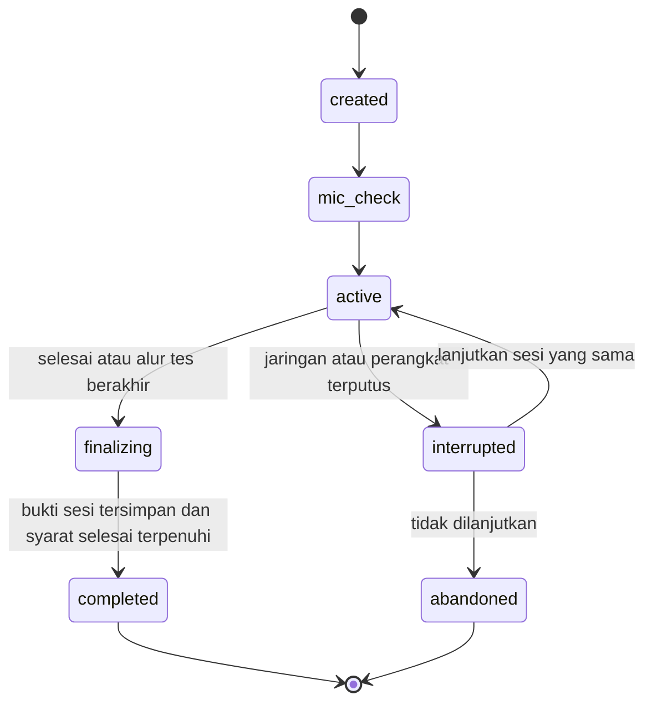
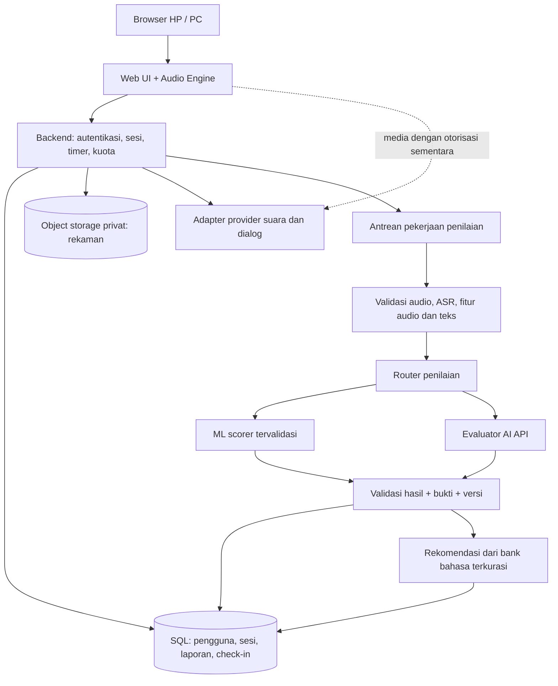
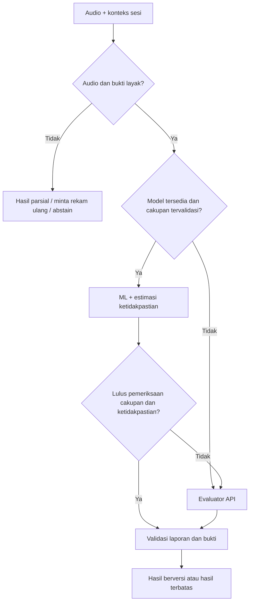
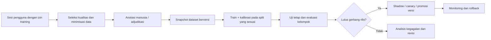

# SpeakWE — latihan speaking bersama Mimo

SpeakWE adalah rancangan aplikasi web untuk latihan **conversation sehari-hari** dan **IELTS Speaking**. Pengguna berbicara dengan Mimo, maskot axolotl yang ramah. Fokus belajarnya adalah kelancaran berbicara, lalu memperbaiki ketepatan bahasa dan memperluas pilihan ungkapan melalui umpan balik setelah sesi.

Dokumen ini menjadi acuan produk, pengalaman pengguna, arsitektur, data, penilaian, suara, dan urutan pembangunan. Bahasa antarmuka awal direncanakan Indonesia; percakapan latihan menggunakan bahasa Inggris.

**Status per 22 Oktober 2026: aset, referensi, dan dataset vocabulary v2 tersedia dengan koreksi kelas kata, filter mutu terjemahan dan 132 arti terkurasi. Aplikasi percakapan, backend, database produksi, dan model penilai belum diimplementasikan.** Semua bagian berlabel “rancangan”, “usulan”, atau “target” di bawah belum merupakan fitur yang berjalan.

## Daftar isi

1. [Status repositori](#1-status-repositori)
2. [Kebutuhan produk](#2-kebutuhan-produk)
3. [Alur latihan dan check-in](#3-alur-latihan-dan-check-in)
4. [Rancangan layar dan karakter Mimo](#4-rancangan-layar-dan-karakter-mimo)
5. [Arsitektur sistem](#5-arsitektur-sistem)
6. [Penilaian yang jujur dan fokus fluency](#6-penilaian-yang-jujur-dan-fokus-fluency)
7. [Dataset dan materi yang sudah tersedia](#7-dataset-dan-materi-yang-sudah-tersedia)
8. [Bank vocab, idiom, collocation, dan connectors](#8-bank-vocab-idiom-collocation-dan-connectors)
9. [ML sendiri dan fallback API](#9-ml-sendiri-dan-fallback-api)
10. [Suara Mimo yang smooth dan natural](#10-suara-mimo-yang-smooth-dan-natural)
11. [Model data dan kontrak API](#11-model-data-dan-kontrak-api)
12. [Teknologi dan struktur kode](#12-teknologi-dan-struktur-kode)
13. [Privasi, keamanan, dan biaya](#13-privasi-keamanan-dan-biaya)
14. [Menjalankan persiapan data lokal](#14-menjalankan-persiapan-data-lokal)
15. [Roadmap dan kriteria selesai](#15-roadmap-dan-kriteria-selesai)
16. [Keputusan yang masih terbuka](#16-keputusan-yang-masih-terbuka)
17. [Referensi teknis](#17-referensi-teknis)

## 1. Status repositori

Repository tujuan: [zalfredz/SpeakWE](https://github.com/zalfredz/SpeakWE). **Folder kerja aktif mulai 22 Oktober 2026: `C:\Users\Asus TUF\Downloads\SpeakWE`.** Semua pekerjaan berikutnya menggunakan folder ini.

Folder hasil pemindahan saat diperiksa belum memiliki direktori `.git`, sehingga belum menjadi working tree Git. File `.gitignore` tetap tersedia sebagai aturan untuk saat Git dipulihkan/disiapkan; keberadaannya sendiri tidak mengaktifkan version control.

| Komponen | Status nyata |
| --- | --- |
| Konsep produk dan kebutuhan utama | Dituangkan dalam dokumen ini |
| Aset Mimo | Video pilihan kedua, poster PNG/WebP, dan berkas font sudah ada |
| Import referensi PDF | Script dan hasil JSON lokal tersedia |
| Dataset vocabulary teks | [Dataset v2](../data/vocabulary/v2/README.md): 9.977 entri kata/POS, 15 koreksi POS, 132 arti terkurasi, 12.265 tautan Indonesia berstatus Y dari sumber; 127 profil multilevel tetap dipertahankan; belum verifikasi Cambridge menyeluruh |
| Bank idiom IELTS Speaking | [Bank idiom v1](../data/language-bank/README.md): 60 idiom + 8 ungkapan terkait, arti Indonesia, pola, pasangan contoh asli, konteks dan tautan Cambridge; 8 tes lulus; pilot editor AI |
| Sumber grammar, paraphrase dan pertanyaan | [Riset 18 sumber](grammar-paraphrase-and-question-sources.md) dan [katalog terstruktur](../data/catalog/text-coaching-sources.json); metadata kandidat saja, belum impor corpus atau bank soal |
| Inventaris corpus audio publik | [Strategi data](data-strategy.md) dan [registry sumber](../data/catalog/source-registry.json) tersedia; corpus audio belum diunduh di percakapan ini |
| Dataset audio YouTube band 5–9 | 172 video dengan audio, transkrip, dan label band; lokal dan privat (lihat [strategi data](data-strategy.md#intake-link-youtube-dari-pengguna)) |
| Dataset audio dengan nilai dari penilai terlatih SpeakWE | **0 contoh** |
| Web aplikasi yang bisa digunakan | Belum ada; `dist/` baru berisi aset |
| Percakapan suara, login, check-in, laporan | Belum dibuat |
| Model ML penilai | Belum dilatih atau divalidasi |
| Hosting | Manifest Sites tersedia; belum ada versi aplikasi yang dipublikasikan |

Saat ini belum ada `package.json`, perintah `npm run dev`, atau server aplikasi. Membuka folder aset belum menghasilkan aplikasi SpeakWE. README ini juga tidak berarti perubahan sudah di-commit atau di-push ke GitHub.

## 2. Kebutuhan produk

### 2.1 Hal yang sudah disepakati

- Berbasis web, dapat dibuka dari HP dan PC, dengan target Safari dan Google Chrome.
- Pengguna langsung melihat Mimo di halaman awal.
- **Daily Conversation:** pilih topik harian atau gunakan topik acak, lalu berbicara dua arah dengan Mimo.
- **IELTS Speaking:** pilih Part 1, Part 2, Part 3, atau simulasi penuh Part 1–3. Topik IELTS diacak dari bank yang sudah ditinjau.
- Selama latihan, jawaban Mimo disampaikan **melalui suara**. Transkrip percakapan dapat dibuka setelah sesi selesai.
- Satu sesi yang selesai memenuhi daily check-in; membuka aplikasi saja tidak cukup.
- Sesudah latihan tersedia rangkuman kesalahan, kekurangan, bukti dari jawaban, dan langkah perbaikan.
- Rekomendasi dapat mencakup vocab B2–C2, verb, idiom, collocation, phrasal verb, dan discourse marker yang sesuai konteks.
- Prioritas belajar adalah **fluency**. Penilaian harus realistis, tidak memberikan pujian atau band tinggi tanpa bukti.

### 2.2 Tiga kemampuan utama

| Kemampuan | Hasil yang dirasakan pengguna |
| --- | --- |
| Daily check-in latihan speaking | Kebiasaan latihan tercatat setelah sesi selesai, termasuk latihan materi IELTS |
| IELTS assessment dan rangkuman | Pengguna memahami kemampuan, kelemahan, serta alasan estimasi penilaian |
| Daily Conversation | Pengguna mendapat waktu berbicara dan tanggapan yang terasa seperti percakapan |

**Batas versi awal:** latihan suara, laporan, dan riwayat terlebih dahulu. Multiplayer, kelas guru, leaderboard, pembayaran, aplikasi native, serta pembuatan animasi 3D real-time belum termasuk kebutuhan yang disepakati.

## 3. Alur latihan dan check-in

### 3.1 Daily Conversation

1. Pengguna membuka Home dan bertemu Mimo.
2. Memilih topik: misalnya makanan, rutinitas, pekerjaan, perjalanan, atau acak.
3. Menekan **Mulai**, mengizinkan mikrofon, dan memeriksa suara.
4. Mimo memberi pertanyaan pembuka pendek.
5. Pengguna menjawab; Mimo menanggapi isi jawaban dan memberi satu pertanyaan lanjutan.
6. Pengguna menyelesaikan sesi melalui tombol selesai. Usulan awal: sesi terpandu singkat dengan beberapa giliran jawaban; batas validnya ditetapkan di konfigurasi produk.
7. Sistem memfinalisasi rekaman, mencatat check-in, lalu memproses laporan.
8. Pengguna membuka transkrip, melihat 1–3 prioritas perbaikan, dan dapat mengulang jawaban.

Selama berbicara, Mimo tidak terus-menerus menghentikan pengguna untuk membetulkan grammar atau menyisipkan idiom. Koreksi utama diberikan setelah sesi. Jika pengguna kesulitan, Mimo dapat mengajukan pertanyaan yang lebih sederhana tanpa mengarang bahwa kemampuan pengguna meningkat.

### 3.2 IELTS Speaking

| Pilihan | Perilaku yang direncanakan |
| --- | --- |
| Part 1 | Pertanyaan tentang diri dan topik yang familier; pertanyaan lanjutan relevan |
| Part 2 | Cue card acak, waktu persiapan, lalu giliran berbicara panjang |
| Part 3 | Diskusi lebih abstrak dan mendalam; pada simulasi penuh dikaitkan dengan tema Part 2 |
| Full test | Part 1 → Part 2 → Part 3 secara berurutan; tidak melompati bagian hanya karena LLM mengusulkannya |

Durasi acuan tes Speaking adalah sekitar 11–14 menit; Part 2 mencakup satu menit persiapan dan hingga dua menit berbicara. Latihan per bagian dapat dibuat lebih singkat dan harus diberi label latihan. [Sumber: penjelasan resmi IELTS](https://ielts.org/news-and-insights/demystifying-the-ielts-speaking-test).

Dalam simulasi, Mimo berperan sebagai penguji yang ramah tetapi netral: memberi instruksi dan pertanyaan, tidak mengajari jawaban di tengah tes, dan tidak membocorkan penilaian sementara. Interupsi akhir waktu adalah bagian alur tes, sedangkan jeda berpikir singkat bukan alasan otomatis untuk mengakhiri jawaban Part 2.

Topik diacak **di server** dari materi berstatus disetujui. Simpan seed/ID pilihan dan versi bank agar sesi dapat diaudit. Pertanyaan hasil generasi AI masuk antrean tinjauan sebelum menjadi materi resmi bank.

### 3.3 Mesin status sesi



Penilaian mempunyai status terpisah: `queued → processing → ready / partial / failed`. Check-in tidak perlu menunggu API penilaian selesai. Kegagalan penilai tidak boleh menghilangkan latihan yang sudah diselesaikan.

### 3.4 Aturan check-in yang diusulkan

- Server menetapkan sesi selesai berdasarkan alur, keberadaan jawaban pengguna, dan durasi bicara yang memadai untuk jenis latihan; nilainya bukan syarat kelulusan.
- Sesi kosong, rekaman hening, atau sesi yang ditinggalkan tidak langsung menghasilkan check-in. Gangguan teknis ditangani dengan lanjutkan/ulang rekaman.
- Simpan waktu dalam UTC, hitung tanggal latihan menurut zona waktu akun. Usulan awal untuk pengguna Indonesia: `Asia/Jakarta`, dapat diubah di pengaturan.
- Gunakan batas unik `(user_id, local_date)` untuk satu check-in harian dan kunci idempotensi penyelesaian sesi. Menekan tombol dua kali tidak menambah streak dua kali.
- Kebijakan zona waktu dibekukan untuk hari berjalan; perubahan tidak membuat kredit ganda. Streak dihitung dari tanggal berurutan, bukan selisih kelipatan 24 jam.
- Check-in menunjukkan konsistensi latihan, bukan bukti band IELTS naik.

## 4. Rancangan layar dan karakter Mimo

### 4.1 Peta layar

| Layar | Isi dan tindakan utama |
| --- | --- |
| Home | Mimo, status check-in, tombol Daily Conversation dan IELTS Speaking |
| Pilih latihan | Topik harian; pilihan bagian IELTS atau full test; estimasi durasi |
| Pemeriksaan audio | Izin mikrofon, indikator input, tes suara singkat |
| Ruang latihan | Mimo besar, status mendengarkan/berpikir/berbicara, mikrofon, selesai; timer sesuai mode |
| Hasil | Ringkasan, bukti kesalahan, transkrip/replay, upgrade jawaban, latihan ulang |
| Riwayat | Sesi, check-in, perkembangan pada latihan yang sebanding |
| Expression Bank | Ungkapan yang disimpan, arti, contoh, dan konteks penggunaannya |
| Pengaturan | Suara, kecepatan, perangkat audio, zona waktu, penyimpanan dan penghapusan data |

Usulan desktop: navigasi di kiri, area Mimo di tengah, status sesi ringkas di samping. Usulan HP: satu kolom dengan tombol mikrofon/selesai mudah dijangkau. Jangan memenuhi ruang latihan dengan transkrip yang terus berjalan.

**Pengecualian penting:** cue card Part 2 perlu tampil sebagai materi tugas, terpisah dari transkrip jawaban Mimo. Kontrol, timer, dan status tetap memiliki label teks/aksesibilitas. Jika pengguna meminta caption sebagai akomodasi, tampilkan sebagai opsi aksesibilitas dengan label yang jelas.

### 4.2 Arah visual

- Mimo berupa axolotl lucu dengan tampilan lembut seperti karakter 3D; tampil seluruh badan pada ruang latihan jika ukuran layar memungkinkan.
- Usulan warna: lilac, peach, ivory, dan teks gelap dengan kontras yang cukup. Palet final belum dikunci.
- Ekspresi mengikuti fungsi: menyapa, mendengarkan, menunggu, berbicara, memberi dorongan, dan merayakan check-in secara ringan.
- Hindari gerakan kepala/mulut ekstrem, kedipan terlalu sering, atau deformasi karakter. Demo animasi prosedural sebelumnya tidak menjadi standar aset yang disetujui.
- Logo kecil menggunakan siluet kepala Mimo yang sederhana dan tetap terbaca pada ukuran favicon; aset logo final belum tersedia.

### 4.3 Aset yang benar-benar tersedia

| File | Kegunaan dan batasnya |
| --- | --- |
| [mimo-greeting.mp4](../dist/assets/mimo-greeting.mp4) | Basis video PixVerse pilihan kedua, sekitar 6,04 detik, 960×960, 24 fps; belum merupakan animasi bicara yang tersinkron |
| [mimo-poster.webp](../dist/assets/mimo-poster.webp) | Poster ringan/fallback ketika video belum siap atau gerakan dikurangi |
| [mimo-poster.png](../dist/assets/mimo-poster.png) | Poster PNG |
| [dm-sans.woff2](../dist/assets/dm-sans.woff2) | Berkas font yang tersedia; metadata, cakupan bobot, dan lisensinya diperiksa sebelum rilis |

Video masih memiliki latar ivory dan watermark PixVerse, tidak transparan. Sambungan akhir-awal masih perlu dipoles sebelum menjadi loop produksi. Track audio bawaan video dimatikan; suara Mimo berasal dari sistem suara aplikasi.

Untuk MVP, gunakan video sebagai idle/greeting dengan poster cadangan dan indikator status. Jangan mengklaim lip-sync dari video ini. Animasi berbicara yang benar memerlukan aset mulut/viseme atau rig karakter tersendiri yang digerakkan oleh audio. Animasi dan suara merupakan dua jalur yang berbeda.

## 5. Arsitektur sistem

### 5.1 Gambaran rancangan



Diagram ini menunjukkan target modular, bukan layanan yang sudah terpasang. Jalur media langsung ke provider digunakan hanya jika didukung dan diotorisasi backend. Selain jalur tersebut, pipeline suara dapat diproksikan lewat server sesuai kebutuhan provider.

### 5.2 Tanggung jawab komponen

| Komponen | Tanggung jawab |
| --- | --- |
| Web UI | Tampilan responsif, kontrol sesi, aksesibilitas, hasil latihan |
| Audio Engine | Mikrofon, rekaman input, playback, antrean audio, interupsi, pemulihan perangkat |
| Session Controller | Mode, pertanyaan, timer, transisi bagian, penyelesaian dan check-in; server adalah sumber kebenaran |
| Dialogue Service | Memahami konteks dan membuat tanggapan Mimo sesuai peran; tidak menentukan sendiri nilai final |
| Assessment Worker | Memeriksa audio, transkripsi analisis, fitur, pemanggilan scorer, dan laporan |
| Language Bank | Materi dan ungkapan yang sudah ditinjau beserta sumber/versinya |
| ML Service | Inferensi model dan ketidakpastian yang sudah diuji; terpisah dari proses pelatihan |
| Training Pipeline | Seleksi data berizin, anotasi, pelatihan, evaluasi, registry, promosi dan rollback |

**Pemisahan penting:** model percakapan bertugas membuat percakapan enak diikuti; model penilai bertugas menilai bukti. Sikap ramah Mimo tidak boleh menjadi alasan menaikkan band.

### 5.3 Alur setelah sesi selesai

1. Finalisasi manifest rekaman: ID bagian, urutan, waktu, durasi, ukuran, hash, dan status upload.
2. Verifikasi kelengkapan/kelayakan sesi, simpan completion dan check-in dalam transaksi.
3. Antrekan satu pekerjaan assessment dengan kunci `session_id + assessment_version`.
4. Periksa kualitas rekaman, lakukan transkripsi, susun fitur dan bukti.
5. Pilih scorer sesuai kesiapan model serta kelayakan input.
6. Validasi schema, rentang nilai, timestamp, kecukupan bukti, dan konsistensi laporan.
7. Cari alternatif bahasa dari bank terkurasi; jelaskan hanya penggantian yang mempertahankan maksud.
8. Simpan hasil berversi, beri tahu UI bahwa laporan siap. Jika gagal, sediakan retry tanpa menggandakan biaya/check-in secara tidak terkendali.

## 6. Penilaian yang jujur dan fokus fluency

### 6.1 Empat kriteria IELTS

| Kriteria | Bukti yang diperlukan |
| --- | --- |
| Fluency and Coherence | Kelangsungan bicara, jenis jeda, pengulangan, perbaikan diri, hubungan ide, pengembangan jawaban; perlu audio dan teks |
| Lexical Resource | Ketepatan dan fleksibilitas kosakata, parafrasa, collocation, ungkapan idiomatik yang sesuai |
| Grammatical Range and Accuracy | Ragam struktur, ketepatan, pola kesalahan, dampak terhadap pemahaman |
| Pronunciation | Keterpahaman, bunyi, stress, ritme, intonasi, connected speech; perlu audio |

Keempat kriteria berbobot sama dalam IELTS Speaking. Fokus produk pada fluency mengatur **urutan latihan dan prioritas coaching**, bukan mengubah bobot IELTS menjadi skor fluency dominan. [Sumber resmi IELTS](https://ielts.org/news-and-insights/demystifying-the-ielts-speaking-test).

Gunakan penilaian berbasis deskriptor, bukti positif dan pembatas band. Jangan mengubah 12 checklist observasi menjadi 12 poin yang dijumlahkan. Rubrik PDF pengguna masih kandidat dan harus ditinjau edisinya sebelum scoring diaktifkan. [Rubrik resmi untuk pembandingan](https://ielts.org/cdn/ielts-guides/ielts-speaking-band-descriptors.pdf).

### 6.2 Aturan anti-penilaian terlalu baik

- Setiap estimasi kriteria memerlukan bukti relevan, termasuk keterbatasan yang menjelaskan mengapa band berikutnya belum tercapai.
- Tidak ada bonus otomatis karena jumlah idiom, connector, kata C2, atau durasi jawaban. Kecocokan dan ketepatannya yang dinilai.
- Jangan memberi nilai pronunciation berdasarkan transkrip saja, atau menyimpulkan fluency dari transkrip yang sudah dibersihkan.
- Simpan **transkrip analisis verbatim** beserta jeda, pengulangan, dan self-correction; versi bacaan yang dirapikan disimpan terpisah jika diperlukan.
- Kesalahan ASR bukan otomatis kesalahan pengguna. Tautkan temuan penting ke audio dan tandai ketidakpastian.
- Audio kosong/rusak, sampel terlalu singkat, atau bukti tidak cukup menghasilkan `insufficient_evidence`/hasil parsial, bukan band 0 atau nilai tebakan.
- Latihan satu bagian menghasilkan estimasi terbatas pada sampel tersebut. Jangan tampilkan seolah-olah hasil tes Speaking penuh.
- Overall hanya dihitung ketika empat kriteria dan cakupan sesi memenuhi kebijakan penilaian. Kebijakan agregasi/pembulatan harus berversi dan ditinjau sebelum rilis.
- Gunakan sebutan **estimasi latihan SpeakWE**, bukan sertifikat atau nilai resmi IELTS. Akurasi terhadap manusia belum terbukti pada proyek ini.

### 6.3 Coaching fluency harian

Metrik diagnostik yang diusulkan: waktu bicara pengguna, proporsi jeda, panjang rentang bicara, jenis hesitation, pengulangan tanpa fungsi, serta kemampuan mengembangkan ide. Kecepatan bicara hanyalah satu sinyal; berbicara makin cepat bukan selalu makin baik. Bedakan jeda untuk merencanakan isi dengan pencarian kata. [Acuan kriteria IELTS](https://ielts.org/cdn/Guides/ielts-speaking-key-assessment-criteria.pdf).

Laporan Daily Conversation memprioritaskan 1–3 tindakan konkret, misalnya “jawab lalu tambah alasan dan contoh” atau “ulang jawaban ini dengan satu alur ide”. Tidak perlu memaksakan band IELTS pada setiap percakapan santai. Kemajuan dibandingkan pada tugas dan kondisi yang sebanding; perubahan model atau mikrofon dicatat agar grafik tidak menyesatkan.

### 6.4 Bentuk laporan

1. Ringkasan apa yang sudah berjalan baik dan hambatan terbesar, dengan bahasa yang langsung.
2. Estimasi per kriteria jika layak; label cakupan, versi evaluator, dan keterbatasan.
3. Bukti: cuplikan asli, timestamp, tombol dengarkan ulang, dan penjelasan.
4. Upgrade jawaban yang sesuai maksud pengguna, bukan jawaban baru yang terlalu jauh dari kemampuan saat ini.
5. Satu latihan ulang terarah; simpan versi sebelum/sesudah tanpa menghapus hasil lama.

## 7. Dataset dan materi yang sudah tersedia

### 7.1 Tiga jenis data yang berbeda

| Jenis | Contoh | Fungsi |
| --- | --- | --- |
| Referensi/rubrik | Deskriptor band, panduan pengajaran | Acuan penilaian dan coaching; bukan contoh audio berlabel |
| Bank materi/bahasa | Pertanyaan, cue card, arti ungkapan, sense dan CEFR terverifikasi | Memilih tugas dan rekomendasi yang sesuai |
| Dataset penilaian | Audio + transkrip + konteks tugas + skor manusia + bukti | Melatih, mengalibrasi, dan menguji scorer ML |

Mengumpulkan dua PDF tidak sama dengan memiliki dataset untuk melatih penilai speaking. Saat ini belum ada contoh audio yang mendapat penilaian manusia.

### 7.2 Dua PDF yang diberikan pengguna

| Sumber | Hasil persiapan lokal | Batas penggunaan |
| --- | --- | --- |
| `speaking-band-descriptors.pdf`, 1 halaman | 10 baris band 0–9 dan 4 kriteria; band paling rendah memiliki deskripsi global | Edisi tidak tercetak; wording berbeda dari PDF resmi yang saat ini tersedia, perlu review |
| `1. Speaking (inggo).pdf`, 5 halaman | 46 pertanyaan dalam 14 kelompok topik, checklist 12 observasi, pola pengembangan jawaban dan kandidat ungkapan | Dominan pengantar/Part 1; belum cukup untuk bank full test Part 1–3 |

Materi kedua memuat contoh jawaban, tetapi tidak ada nilai examiner yang melekat. Satu pertanyaan tentang komunikasi masa lalu/sekarang belum diklasifikasikan bagian tesnya (`part: null`) dan menunggu review. Kandidat ungkapan belum diberi level CEFR. Bentuk bahasa yang meragukan dalam sumber masuk catatan kurasi, tidak langsung dijadikan contoh benar.

Hasil ada di `data/private/ielts-reference-v1/`: `source-manifest.json`, `rubric-reference.json`, `practice-reference.json`, `observation-checklist.json`, dan `coaching-reference.json`. Manifest menyimpan hash SHA-256 sumber dan hitungan import. Folder ini serta `research/` diabaikan Git; hasilnya tidak ikut build publik. Hak redistribusi sumber belum dinilai.

### 7.3 Yang perlu dikumpulkan berikutnya

- Cue card Part 2 dan pertanyaan Part 3 berpasangan yang ditinjau pengajar.
- Audio berbagai kemampuan, topik, aksen, perangkat, dan kondisi rekaman; disertai izin penggunaan yang jelas.
- Penilaian empat kriteria oleh penilai terlatih; subset penting dinilai dua orang dan diadjudikasi bila berbeda.
- Contoh kasus sulit: jawaban singkat, disfluency, aksen kuat namun jelas, noise, off-topic, atau ASR salah.
- Bank vocab/ungkapan dengan sumber, arti tertentu, register, contoh, serta status review.

Tidak menetapkan angka “sekian ratus data pasti cukup”. Kecukupan ditentukan dari cakupan, learning curve, dan evaluasi terhadap penilaian manusia.

### 7.4 Kandidat corpus eksperimen dari pengguna

Daftar yang diusulkan pengguna telah ditinjau lewat sumber penerbit/pengelola dan dicatat dalam [strategi data](data-strategy.md#2-corpus-untuk-eksperimen). Ringkasannya: speechocean762 untuk eksperimen pronunciation, Common Voice English untuk ASR, Speak & Improve untuk riset learner speech dengan pembatasan nonkomersial, L2-ARCTIC untuk riset pelafalan nonkomersial, dan ICNALE untuk learner Asia setelah syarat akses/penggunaannya dipastikan.

Tidak satu pun menjadi dataset siap pakai untuk **empat nilai IELTS**: CEFR holistik, level peserta, skor read-aloud, dan error fonem merupakan label yang berbeda. Model komersial juga harus melacak sumber data pelatihannya; hasil eksperimen berlisensi terbatas tidak otomatis boleh dipindahkan ke produk. Detail batas dan sumber ada pada dokumen strategi, bukan asumsi bahwa semua dataset publik bebas digunakan.

Pengguna juga mengumpulkan 172 video mock test YouTube band 5–9. Audio, transkrip verbatim bertimestamp, label band, dan skor yang diucapkan examiner disimpan lokal di `data/private/youtube-band-dataset/` (diabaikan Git karena hak cipta). Label berasal dari judul video/pengguna dan feedback examiner channel, bukan penilai terlatih SpeakWE. Alur tinjauan dijelaskan dalam [strategi data](data-strategy.md#intake-link-youtube-dari-pengguna).

## 8. Bank vocab, idiom, collocation, dan connectors

**Pembagian kerja terbaru:** AI lain menangani audio dan transkrip; pekerjaan di sini mencakup **vocabulary A1–C2 dan bank idiom IELTS Speaking**. [Dataset v2](../data/vocabulary/v2/README.md) berisi 9.977 entri kata/POS dengan seluruh klaim sumber, 132 arti terkurasi dan pencarian Indonesia yang menyaring mutu sumber. V1 tetap arsip. Cambridge dipilih sebagai rujukan cek utama; pemeriksaan cuplikan terindeks tidak berarti seluruh bank terverifikasi. [Contoh “makan → level”](../data/vocabulary/v2/examples/makan.json) menyediakan eat A1 dan consume B2 untuk makanan; consume C1 tentang sumber daya dipisahkan. [Bank idiom v1](../data/language-bank/README.md) menambahkan 60 idiom dan 8 ungkapan terkait, 68 pasangan contoh asli serta starter pack 15 idiom. Contoh jawaban panjang dan perluasan collocation/phrasal verb/connector masih backlog.

### 8.1 Struktur entri yang diusulkan

Simpan `expression_id`, `expression`, `category`, `sense_id`, arti Indonesia, contoh lisan, pola grammar/collocation, register, topik, sumber, lisensi, status review, dan `cefr_level`. Level boleh `null` sampai terverifikasi. Satu kata dapat memiliki beberapa arti/level; jangan memberi satu level tetap pada semua penggunaannya. Pisahkan level wordlist pada lemma/part-of-speech dari level yang benar-benar diverifikasi untuk sense/phrase.

**Prioritas aktif:** vocabulary bersumber dan kurasi idiom; target total 200–500 entri ungkapan tetap target perluasan, dengan 68 entri pilot kini tersedia. CEFR-J v1.5 dan Octanove C1/C2 v1.0 telah diimpor dengan atribusi, hash, dan ketentuan sumber yang disertakan; adaptasi gabungan vocabulary memakai CC BY-SA 4.0. Kontribusi asli bank idiom disimpan terpisah dengan [CC BY 4.0](../data/language-bank/LICENSE.md). Oxford tetap ditahan. EVP tidak disalin, di-scrape, atau dijadikan sumber label database komersial. Rincian versi, lisensi, dan alur kurasi ada dalam [strategi bank bahasa](data-strategy.md#1-prioritas-2-bank-bahasa-untuk-laporan) dan [lisensi vocabulary](../data/vocabulary/LICENSE.md).

Kategori meliputi kata kerja, frasa, phrasal verb, collocation, idiom, dan discourse marker. Bank rekomendasi dapat menonjolkan B2–C2, sementara pengukuran kemampuan tetap perlu memahami bahasa di tingkat lebih rendah. C2 bukan sinonim otomatis “lebih baik untuk semua kalimat”.

### 8.2 Cara memberikan upgrade

```text
Cuplikan asli → deteksi maksud dan konteks → cari kandidat terkurasi
→ periksa makna, register, grammar, dan naturalness
→ tawarkan alternatif + alasan + contoh → latihan ulang
```

Contoh ilustratif, bukan hasil penilaian pengguna:

| Jawaban | Alternatif opsional | Penjelasan |
| --- | --- | --- |
| “I like walking after work because it helps me relax.” | “Walking after work helps me recharge my batteries.” | Idiom cocok jika maksudnya memulihkan energi; kalimat asli sudah benar |
| “I like cooking. I don't do it often.” | “I enjoy cooking, although I don't do it very often.” | Connector memperjelas hubungan kontras; tidak harus mengganti kedua kalimat asli |

Tampilkan span asli yang diganti, makna alternatif, perubahan nuansa, dan alasan relevansinya. Jika tak ada penggantian yang lebih cocok, katakan bahwa kalimat asli sudah natural. Jangan menjanjikan kenaikan band karena memasukkan satu idiom. [Panduan resmi IELTS tentang idiom](https://ielts.org/news-and-insights/how-to-use-idioms-in-the-ielts-speaking-test).

Contoh istilah yang perlu dibedakan: `under the weather` berarti merasa kurang sehat; `under the water` bukan pengganti idiom itu. `It's raining cats and dogs` benar sebagai idiom, tetapi penggunaannya tetap bergantung konteks. Jangan menetapkan level B2/C1/C2 untuk contoh tersebut tanpa sumber yang memadai.

Untuk MVP, tabel SQL dengan pencarian berdasarkan kategori, sense, dan topik cukup. Pencarian embedding/RAG dapat ditambahkan ketika bank membesar; vector database tidak wajib sejak awal. Materi kandidat tidak boleh dianggap terverifikasi hanya karena berhasil ditemukan lewat retrieval.

## 9. ML sendiri dan fallback API

### 9.1 Strategi bertahap

Keinginan akhirnya: scorer ML milik SpeakWE menangani input yang telah terbukti dapat dinilai dengan baik; evaluator API membantu kasus di luar cakupan tersebut. Saat ini ML belum siap, sehingga fase awal harus dibalik: evaluator API menjadi baseline sementara dengan audit manusia, dan ML belajar sebagai **shadow model** yang hasilnya belum menentukan laporan pengguna.

| Fase | Penilai yang dipakai | Peran ML |
| --- | --- | --- |
| Persiapan | Belum menampilkan band otomatis | Mengumpulkan referensi dan membuat protokol anotasi |
| Pilot | Evaluator API + pemeriksaan manusia pada sampel | Baseline fitur dan eksperimen offline |
| Shadow | Baseline yang telah diuji tetap melayani | ML menilai diam-diam untuk dibandingkan, tanpa mengubah nilai pengguna |
| Rilis terbatas | ML untuk cakupan tervalidasi; API untuk input valid yang meragukan | Pantau selisih, bias, biaya, dan rollback |
| Operasional | Router memilih jalur dengan kebijakan berversi | Pembaruan berkala setelah evaluasi lulus |

Fallback bukan jaminan kebenaran. Jika API dan ML berbeda jauh, hasil perlu dibatasi, ditinjau, atau ditahan; jangan selalu mengambil angka paling tinggi.

### 9.2 Routing saat scorer ML sudah layak



Audio jelek tidak menjadi bagus dengan mengirimnya ke API yang lebih mahal. Input tanpa bukti yang memadai harus ditandai sejak gerbang awal. Confidence yang ditulis sendiri oleh LLM juga tidak sama dengan ketidakpastian terkalibrasi; kebijakan router harus diuji terhadap data berlabel.

### 9.3 Kandidat pendekatan model

- Mulai dari baseline yang dapat dijelaskan: fitur jeda/kelancaran, fitur teks, dan model ordinal/regresi per kriteria.
- Bandingkan dengan model yang memakai representasi audio dan teks jika data memadai. Fluency dan pronunciation membutuhkan informasi audio; analisis teks saja tidak mencukupi.
- Setiap fitur harus punya definisi: apakah durasi mencakup jeda, bagaimana ujaran tidak dikenali ditangani, dan bagaimana confidence ASR memengaruhi temuan.
- Output utama: estimasi per kriteria, cakupan model, indikator ketidakpastian, dan versi fitur/model. Jangan meminta model mengarang timestamp bukti yang tidak berasal dari pipeline.
- Model berfitur sederhana adalah baseline eksperimen, bukan bukti sudah setara examiner. Pemilihan algoritma final mengikuti hasil validasi.

### 9.4 Supaya semakin dipakai semakin berguna



Pisahkan **database operasional** dari **dataset pelatihan terkurasi**. Rekaman baru masuk antrean kandidat, bukan langsung mengubah bobot model.

- **Gold:** audio dan penilaian manusia yang ditinjau, lengkap dengan provenance.
- **Silver:** label API/pseudo-label yang belum diverifikasi. Boleh untuk eksperimen yang jelas asalnya, bukan satu-satunya dasar evaluasi atau bukti akurasi.
- **Feedback pengguna:** “membantu/tidak membantu” menilai kegunaan laporan, bukan memastikan band benar.
- **Personalisasi:** pilihan topik, latihan, dan ungkapan tersimpan dapat menyesuaikan profil tanpa menunggu retraining global.

Retraining dilakukan setelah terkumpul data terkurasi yang memadai atau ada drift yang terukur. Tidak wajib setiap sesi/hari. Rilis baru harus mengalahkan baseline sesuai gerbang yang ditetapkan, lalu dipantau dan dapat dikembalikan. [Acuan pipeline ML](https://developers.google.com/machine-learning/managing-ml-projects/pipelines).

### 9.5 Evaluasi dan pencegahan kebocoran

- Pisahkan train/validation/test berdasarkan **pembicara**: pengguna yang sama tidak muncul pada train dan test. Deduplikasi audio, transkrip, dan jawaban yang nyaris sama.
- Kelompokkan seluruh take dari sesi/jawaban yang sama pada split yang sama. Tambahkan uji topik baru dan uji waktu yang lebih baru untuk mengukur generalisasi.
- Bekukan test set sebagai gerbang rilis. Jangan menggunakannya berulang untuk menyetel model; gunakan validation set untuk tuning dan audit tambahan ketika diperlukan.
- Ukur kesalahan per kriteria, kesepakatan dalam toleransi band, kesepakatan ordinal, **bias terlalu murah/terlalu ketat**, cakupan abstain, dan kesalahan setelah fallback.
- Bandingkan dengan variasi antarmanusia, bukan hanya satu angka “akurasi”. Audit per kelompok kemampuan, kondisi noise, dan perangkat bila jumlah contoh memungkinkan.
- Uji interval/ketidakpastian dengan cakupan aktual; angka confidence mentah bukan alasan cukup untuk menerima hasil.
- Simpan versi dataset, rubric, fitur, ASR, model, prompt, router, serta kode. Perubahan ASR bisa mengubah penilaian meskipun scorer sama.
- Nilai metrik, batas lolos, ukuran sampel, serta biaya fallback masih **belum ditetapkan**; tetapkan sebelum pilot menyatakan scorer layak.

## 10. Suara Mimo yang smooth dan natural

### 10.1 Rekomendasi utama

Untuk pengalaman yang diinginkan, pilih **suara neural yang terdengar hangat**, kirim audio secara streaming, dan atur giliran bicara dengan sabar. Suara lucu tidak harus bernada sangat tinggi atau seperti robot kartun. Kehalusan gerakan video tidak otomatis memperbaiki suara.

Ada dua jalur yang layak diuji dengan naskah dan perangkat yang sama:

| Jalur | Cara kerja | Kelebihan untuk SpeakWE | Hal yang perlu diuji |
| --- | --- | --- | --- |
| A — pipeline terpisah | Audio → streaming STT/ASR → pengelola dialog + LLM → neural TTS streaming | Kontrol isi pertanyaan, provider suara, biaya komponen, dan logging lebih jelas | Tambahan latensi antar-komponen dan sambungan prosodi |
| B — native speech-to-speech | Audio → model percakapan suara → audio, dengan kontrol sesi dari backend | Potensi interaksi dan turn-taking lebih natural | Harga nyata per sesi, kepatuhan alur IELTS, dukungan rekaman dan bukti, serta kemampuan provider |

**Usulan pembangunan:** siapkan kontrak provider yang sama untuk kedua jalur; mulai pilot A untuk menguji kontrol dialog dan laporan, lalu bandingkan B sebelum mengunci pengalaman suara. Bila kualitas dan biaya B lebih sesuai hasil uji, gunakan B untuk percakapan. Penilaian sesudah sesi tetap terpisah pada kedua jalur.

Kandidat A: layanan ASR, LLM, dan neural TTS, misalnya TTS OpenAI atau ElevenLabs, yang dipilih setelah tes dengar dan anggaran. Kandidat B: layanan conversational audio; dokumentasi OpenAI saat diperiksa mengarahkan aplikasi suara baru ke GPT-Live, dengan Realtime API untuk kebutuhan model sesi/tool-nya. Nama model, akses akun, batas penggunaan, dan harga diperiksa kembali saat implementasi. [Panduan audio OpenAI](https://developers.openai.com/api/docs/guides/audio).

Belum ada provider berbayar yang diaktifkan oleh rancangan ini. Jangan menganggap paket gratis cukup untuk produk. `speechSynthesis` bawaan browser dapat menjadi fallback yang diumumkan, tetapi suara dan kualitasnya bergantung perangkat sehingga tidak menjamin identitas Mimo yang konsisten.

### 10.2 Identitas suara Mimo

Usulan persona yang harus diuji lewat audio:

| Aspek | Daily Conversation | IELTS simulation |
| --- | --- | --- |
| Karakter | Hangat, penasaran, santai, tidak berlebihan | Tenang, jelas, netral |
| Panjang jawaban | Umumnya 1–2 kalimat pendek dan satu pertanyaan lanjutan | Instruksi dan pertanyaan sesuai tahap; tidak memberi ceramah |
| Kecepatan | Nyaman, ritme bervariasi; dapat sedikit diperlambat oleh pengguna | Konsisten dan jelas tanpa terdengar mendikte |
| Intonasi | Sedikit ekspresif, relevan dengan isi | Natural tetapi tidak memberi isyarat nilai |
| Saat pengguna salah | Tetap menanggapi makna; simpan koreksi untuk laporan | Teruskan tes sesuai aturan |
| Pujian | Spesifik dan seperlunya | Hindari “excellent answer!” yang memberi kesan band tinggi |

Contoh instruksi suara/dialog **rancangan**, disesuaikan kemampuan provider:

```text
You are Mimo, a warm and patient English speaking partner.
Use clear, natural spoken English with a gentle, expressive delivery.
Keep your replies brief and ask one relevant question at a time.
Respond to what the learner actually said. Leave room for them to speak.
Allow thinking pauses. Do not treat every hesitation as the end of a turn.
Do not interrupt to correct grammar or insert advanced vocabulary.
Avoid exaggerated excitement and automatic praise.
Follow the session controller's mode, question, and timing instructions.
Never announce or invent an IELTS band during the conversation.
```

Instruksi tidak menggantikan implementasi timer, cancel, dan antrean audio. Pisahkan template per mode agar peran examiner tidak tercampur dengan partner santai.

### 10.3 Membuat prosodi tidak kaku

- Pilih voice melalui tes dengar 3–5 kandidat dengan pertanyaan, tanggapan empatik, angka/nama, dan instruksi tes. Nilai kejelasan, kehangatan, konsistensi, serta rasa lelah setelah beberapa menit.
- Gunakan kalimat yang memang ditulis untuk diucapkan: contractions alami, satu gagasan per frasa, dan tanda baca yang masuk akal. Jangan kirim Markdown, bullet, atau markup internal ke TTS.
- Gunakan nama voice dan pengaturan yang sama sepanjang sesi. Sediakan profil suara berversi agar perubahan bisa dibandingkan.
- Pada pipeline A, kirim potongan frasa/klausa yang punya konteks, bukan request TTS baru untuk setiap token. Pertahankan konteks antarpotongan jika provider mendukungnya.
- Hindari jeda buatan di setiap koma, tawa/filler acak, dan perubahan pitch ekstrem. Atur kecepatan tanpa membuat timbre menjadi aneh, sesuai kemampuan provider.
- Kamus pelafalan dapat membantu nama seperti “Mimo” dan “SpeakWE”. Verifikasi dengan tes dengar, bukan asumsi teks.
- SSML dan emotion tags berbeda antar-model. Jangan mengirim `<break>` secara universal; beberapa model ElevenLabs tidak mendukung tag tersebut. [Panduan delivery TTS ElevenLabs](https://elevenlabs.io/docs/overview/capabilities/text-to-speech/best-practices).

### 10.4 Membuat playback tersambung

1. Mulai output ketika ada audio yang cukup untuk diputar stabil, tanpa menunggu seluruh jawaban selesai dibuat.
2. Gunakan transport/decoder streaming yang didukung. Potongan jaringan tidak selalu merupakan file audio mandiri; jangan memutar setiap potongan MP3 sebagai file terpisah.
3. Jaga urutan paket/frasa dan satu jalur playback aktif per respons. Buffer menyesuaikan kondisi jaringan; buffer terlalu kecil menimbulkan putus-putus, terlalu besar menambah keterlambatan.
4. Beri event `session_id`, `turn_id`, `response_id`, dan nomor urut. Audio dari respons lama harus dibuang setelah pembatalan.
5. Saat jaringan buruk, tampilkan status koneksi dan tawarkan ulang pertanyaan. Jangan memutar respons lama setelah pengguna sudah pindah topik.
6. Pada jalur native browser, utamakan WebRTC jika provider mendukungnya; pada jalur TTS terpisah gunakan streaming/transport yang sesuai API dan browser.

OpenAI mendokumentasikan WebRTC untuk audio browser; alur autentikasi dan event berbeda menurut API sehingga tidak boleh dicampur. ElevenLabs mendokumentasikan streaming serta WebSocket untuk teks yang datang bertahap. [WebRTC OpenAI](https://developers.openai.com/api/docs/guides/voice-webrtc), [optimasi latensi ElevenLabs](https://elevenlabs.io/docs/eleven-api/guides/how-to/best-practices/latency-optimization).

### 10.5 Mimo harus sabar menunggu pengguna

**Masalah umum:** pengguna berhenti sebentar mencari kata, VAD mengira jawabannya selesai, lalu Mimo menyela. Ini sangat mengganggu latihan fluency.

- Gunakan deteksi akhir giliran yang mempertimbangkan ujaran/konteks bila tersedia. Untuk learner, mulai pengujian dengan pengaturan lebih sabar, kemudian ukur salah potong vs waktu tunggu.
- Jika memakai Realtime yang mendukung semantic VAD, `eagerness: low` adalah salah satu kandidat konfigurasi untuk memberi waktu pengguna. Jangan menyalin pengaturan itu ke provider lain tanpa dukungan. [Dokumentasi VAD OpenAI](https://developers.openai.com/api/docs/guides/realtime-vad).
- Sediakan kontrol **Selesai bicara** sebagai bantuan ketika deteksi otomatis gagal. Kontrol ini berbeda dengan **Selesai sesi**.
- Part 2 memakai giliran panjang dan timer bagian. Jangan membiarkan VAD percakapan biasa mengubah jeda singkat menjadi pertanyaan baru.
- Ketika pengguna mulai bicara saat Mimo masih berbicara, sistem harus menangani interupsi sesuai mode: hentikan generasi/antrean output yang relevan, bersihkan audio lama, dan catat bagian respons yang benar-benar terdengar.
- Jangan memasukkan seluruh respons yang dibatalkan sebagai konteks seolah pengguna mendengarnya. Terapkan penyesuaian riwayat sesuai event playback provider.
- Pisahkan sinyal echo dari ucapan pengguna. Uji speaker HP, headset, dan Bluetooth agar Mimo tidak menanggapi suaranya sendiri.

### 10.6 Browser, rekaman, dan animasi

- Mulai mikrofon/playback melalui tombol pengguna dan tangani penolakan izin atau playback yang diblokir. HTTPS diperlukan pada deployment untuk akses mikrofon. [getUserMedia](https://developer.mozilla.org/en-US/docs/Web/API/MediaDevices/getUserMedia), [autoplay](https://developer.mozilla.org/en-US/docs/Web/Media/Guides/Autoplay).
- Pilih codec rekaman melalui capability detection `MediaRecorder.isTypeSupported()`, kemudian verifikasi hasilnya di perangkat nyata; jangan mengasumsikan satu format berlaku di semua Safari/Chrome. Normalisasi di server tanpa mengubah tempo. [Dokumentasi MediaRecorder](https://developer.mozilla.org/en-US/docs/Web/API/MediaRecorder/isTypeSupported_static).
- Rekam jalur input mikrofon pengguna secara terpisah dari output Mimo. Simpan informasi pemrosesan perangkat/noise suppression; rekaman browser bukan jaminan audio mentah tanpa pemrosesan.
- Interupsi telepon, tab di-background, layar terkunci, atau perangkat audio berganti harus menghasilkan pause/recovery yang jelas. Jangan menjanjikan sesi tetap berjalan di background sebelum diuji.
- Untuk visual, gunakan status `idle / listening / thinking / speaking / celebrating / error`, dengan poster sebagai fallback. Status speaking mengikuti playback aktual, bukan sekadar LLM mulai menghasilkan teks.
- Respect `prefers-reduced-motion`; suara, kontrol, dan alur latihan tetap berfungsi ketika video tidak berjalan.
- Lip-sync detail merupakan pekerjaan aset/rig lanjutan. MVP dapat menggunakan idle Mimo dan indikator audio yang halus tanpa menggambar ulang karakter dengan bentuk yang mengubah tampilannya.

### 10.7 Cara membuktikan suara sudah enak

Catat waktu: akhir bicara pengguna yang terkonfirmasi, teks/hasil model pertama, paket audio pertama, dan audio pertama benar-benar terdengar. Laporkan p50/p95 latensi **ujung ke ujung**, bukan hanya waktu inferensi provider.

Target awal untuk pilot, **belum hasil pengujian**: tanggapan terasa cepat, tidak ada jeda sambungan yang mengganggu, tidak sering memotong jeda berpikir, interupsi menghentikan audio lama, dan suara konsisten selama sesi. Angka batas rilis ditetapkan setelah baseline perangkat/jaringan Indonesia diukur.

Uji dengar setidaknya mencakup: jawaban ragu-ragu, jeda di tengah kalimat, interupsi, jawaban panjang Part 2, suara kecil, angka/nama, jaringan melambat, dan percakapan beberapa menit. Lakukan di Safari iPhone, Chrome Android, serta browser desktop target. Beri prioritas pada penilaian pengguna tentang naturalness dan kenyamanan; konfigurasi voice saja belum membuktikan hasilnya.

## 11. Model data dan kontrak API

Semua tabel dan endpoint di bagian ini adalah **rancangan**, belum tersedia. Model SQL harus disesuaikan dengan database yang dipilih dan memakai migrasi berversi.

### 11.1 Tabel inti

| Tabel | Field/relasi penting |
| --- | --- |
| `users`, `user_preferences` | ID internal, referensi auth, bahasa UI, timezone, profil suara, preferensi penyimpanan |
| `practice_sessions` | Pemilik, mode, bagian IELTS, status, waktu mulai/selesai, timezone snapshot, versi alur dan bank |
| `session_turns` | Sesi, speaker, pertanyaan, urutan, waktu, status final, ID respons provider; tidak mencampur pengguna/Mimo |
| `audio_assets` | Object key privat, pemilik/sesi/turn, codec, durasi, checksum, status upload, tanggal kedaluwarsa |
| `transcript_segments` | Speaker, teks verbatim, awal/akhir audio, confidence bila tersedia, versi ASR, status review |
| `assessment_jobs` | Sesi, versi assessment, status, attempts, idempotency key, error code |
| `assessments`, `criterion_results` | Scope, status, band nullable, alasan, versi evaluator/rubrik/router, provenance dan keterbatasan |
| `feedback_items` | Kriteria, bukti span/timestamp, jenis masalah, saran, status kepastian |
| `daily_checkins` | Pengguna, tanggal lokal, timezone snapshot, sesi sumber; unik per pengguna/tanggal |
| `topics`, `questions`, `cue_cards` | Mode/bagian, sumber, versi, status review, pasangan tema Part 2–3 |
| `lexical_entries`, `saved_expressions` | Sense, kategori, CEFR nullable, register, sumber/review; pilihan simpan pengguna |
| `consent_events` | Jenis izin, waktu, versi pemberitahuan, status penarikan |
| `training_candidates`, `annotations` | Referensi data berizin, rater, label per kriteria, bukti, status adjudikasi |
| `dataset_versions`, `model_versions` | Snapshot, split, konfigurasi, metrik, lokasi artefak, checksum, status promosi |

Simpan file audio di object storage, bukan blob besar di tabel utama. Akses memakai pemeriksaan pemilik dan URL bertanda tangan berumur pendek. Menghapus sesi harus menelusuri audio, transkrip, hasil, serta kandidat pelatihan terkait sesuai kebijakan retensi.

### 11.2 Kontrak laporan contoh

Contoh ini menunjukkan kondisi bukti belum cukup. `null` memang disengaja; bukan skor contoh yang mengesankan penilai sudah bekerja.

```json
{
  "schema_version": 1,
  "session_id": "example-session",
  "scope": "ielts_part_1_practice",
  "status": "insufficient_evidence",
  "overall_estimate": null,
  "criteria": {
    "fluency_and_coherence": {"band": null, "evidence": []},
    "lexical_resource": {"band": null, "evidence": []},
    "grammatical_range_and_accuracy": {"band": null, "evidence": []},
    "pronunciation": {"band": null, "evidence": []}
  },
  "limitations": ["Belum ada audio yang layak dianalisis."],
  "next_action": "record_again",
  "provenance": {
    "evaluator_type": null,
    "model_version": null,
    "rubric_version": null,
    "prompt_version": null,
    "router_version": null
  }
}
```

Bukti laporan siap harus menunjuk `turn_id`, `segment_id`, `start_ms`, `end_ms`, dan kutipan asli jika relevan. Validator memastikan timestamp berada dalam rekaman, kutipan sesuai transkrip, serta tidak ada field/nilai di luar schema. Penjelasan yang lancar bukan bukti schema atau scoring benar.

### 11.3 Endpoint yang direncanakan

| Endpoint | Fungsi |
| --- | --- |
| `POST /api/sessions` | Buat sesi, pilih pertanyaan di server, simpan konfigurasi |
| `POST /api/sessions/:id/voice` | Otorisasi koneksi audio; mintakan credential sementara atau negosiasikan koneksi sesuai provider |
| `POST /api/sessions/:id/audio-uploads` | Persiapkan upload dengan batas ukuran/durasi dan kepemilikan |
| `POST /api/sessions/:id/events` | Terima event kontrol tervalidasi; nomor urut dan deduplikasi |
| `POST /api/sessions/:id/complete` | Finalisasi sekali, simpan check-in, antrekan penilaian |
| `GET /api/sessions/:id/report` | Status/laporan milik pengguna yang sedang login |
| `GET /api/history` | Riwayat dengan pagination |
| `GET /api/checkins` | Kalender check-in dan streak |
| `POST /api/saved-expressions` | Simpan rekomendasi yang dipilih |
| `DELETE /api/sessions/:id` | Ajukan penghapusan sesi dan data turunan |

Gunakan kunci idempotensi untuk create/complete/upload-finalize sesuai kontrak. `complete` yang diulang mengembalikan sesi yang sama. Penilaian asynchronous mengembalikan status pending, bukan menahan koneksi HTTP sampai pekerjaan panjang selesai. Reconnect memakai ID sesi dan event terakhir yang sudah diakui; jangan mengulang seluruh percakapan otomatis.

Kontrol server tidak boleh bergantung pada event atau nilai dari browser saja. Auth, ownership, batas kuota, transisi mode, dan status pertanyaan diperiksa kembali. Transkrip pengguna dan teks materi adalah input tidak tepercaya: instruksi di dalamnya tidak boleh mengganti rubrik, system prompt, atau aturan penilaian.

## 12. Teknologi dan struktur kode

### 12.1 Pilihan teknologi yang diusulkan

| Lapisan | Usulan | Status/pertimbangan |
| --- | --- | --- |
| UI | React + TypeScript, layout responsif | Belum diinisialisasi; pilih framework sesuai hosting |
| Web server/BFF | TypeScript, controller sesi dan adapter provider | Jika memakai Sites, ikuti runtime/deployment yang didukung; Vinext/Workers menjadi kandidat |
| SQL | D1 untuk jalur Workers atau PostgreSQL pada hosting lain | Belum dipilih; SQL/migrasi harus mengikuti engine sebenarnya |
| Audio storage | Bucket privat seperti R2 atau storage kompatibel yang didukung host | Retensi dan URL bertanda tangan diperlukan |
| Antrean | Queue/job runner sesuai host, retry dengan backoff dan deduplikasi | Jangan menjalankan assessment panjang di request halaman |
| Voice/dialogue | Adapter ASR/dialogue/TTS atau native audio | Provider, model, dan anggaran belum dipilih |
| ML inference | Layanan Python terpisah, misalnya FastAPI, bila model membutuhkan ekosistem Python | Hosting CPU/GPU terpisah; jangan mengasumsikan server Python berat berjalan di Worker |
| Training | Python offline/job terjadwal + registry artefak | Tidak ditempatkan dalam proses web pengguna |
| Monitoring | Event teknis terstruktur, metrik latensi/biaya/kegagalan | Hindari merekam isi percakapan sensitif pada log umum |

Modular tidak berarti harus membuat banyak microservice sejak hari pertama. MVP dapat berupa satu aplikasi web/backend, satu antrean, SQL, storage, dan provider API. Pisahkan layanan ML ketika eksperimen/inferensi memang membutuhkannya.

### 12.2 Struktur yang sudah ada

```text
SpeakWE/
├── README.md
├── .gitignore
├── docs/
│   └── data-strategy.md               # kandidat sumber, batas penggunaan, rencana kurasi
├── .openai/
│   └── hosting.json                  # manifest; bukan bukti sudah deploy
├── dist/
│   └── assets/
│       ├── mimo-greeting.mp4
│       ├── mimo-poster.png
│       ├── mimo-poster.webp
│       └── dm-sans.woff2
├── scripts/
│   ├── ingest-reference-materials.py  # import, bukan scorer/trainer
│   ├── build-vocabulary.py            # build dari sumber leksikal yang dipin
│   ├── query-vocabulary.py            # pencarian arsip v1
│   ├── build-vocabulary-v2.py         # koreksi, mutu terjemahan dan arti terkurasi
│   ├── query-vocabulary-v2.py         # pencarian aktif tanpa API key
│   └── restore-vocabulary-sources.py  # ambil ulang sumber hilang + verifikasi hash
├── research/                         # lokal, diabaikan Git
│   └── provided-pdfs/
└── data/
    ├── catalog/
    │   └── source-registry.json        # metadata sumber; bukan corpus atau bank terisi
    ├── vocabulary/                    # v2 aktif, v1 arsip, sumber, kurasi, lisensi, QA
    └── private/
        └── ielts-reference-v1/        # JSON referensi; diabaikan Git
```

Folder privat tidak akan ikut clone baru. Pengembang lain perlu sumber yang memang berhak diakses dan menjalankan import lokal. Jangan memindahkan folder privat ke `dist/` untuk memudahkan frontend.

### 12.3 Struktur pengembangan yang dituju

Nama direktori berikut adalah rancangan; sesuaikan konvensi framework saat inisialisasi, bukan menyalin sebagai bukti implementasi.

```text
src/
  ui/                    # halaman, komponen, tema, aksesibilitas
  audio/                 # capture, playback, interruption, recovery
  domain/                # aturan sesi, check-in, laporan
  server/                # auth, route handler, DB, antrean
  providers/             # adapter voice, ASR, dialog, evaluator
  contracts/             # schema event/API/report, versioning
services/
  assessment/            # worker dan integrasi scorer
ml/
  features/              # ekstraksi konsisten train/inference
  training/              # eksperimen dan pipeline offline
  evaluation/            # split, metrik, release gates
db/migrations/           # migrasi sesuai SQL engine yang dipilih
tests/                   # pengujian aturan kritis dan integrasi
```

Kontrak provider perlu mengungkap kemampuan seperti streaming, cancel, interupsi, semantic turn detection, format audio, serta pelaporan pemakaian. Jangan membuat seolah setiap provider mendukung event dan credential yang sama. Tetapkan model lewat konfigurasi server dan pin versi SDK setelah framework/provider dipilih.

## 13. Privasi, keamanan, dan biaya

### 13.1 Data suara dan izin penggunaan

Rekaman dibutuhkan untuk laporan dan replay, sehingga pengguna perlu mengetahui apa yang direkam, untuk apa, provider mana yang memprosesnya, dan berapa lama disimpan. Tetapkan kebijakan retensi sebelum mengumpulkan data pilot.

- Pisahkan persetujuan pemrosesan sesi dari **opt-in penggunaan untuk pelatihan**. Menolak training tidak menghalangi fungsi latihan utama.
- Usulan default: rekaman privat, tidak dipublikasikan, tidak masuk dataset training tanpa izin yang sesuai. Durasi simpan audio/transkrip belum diputuskan.
- Latihan dapat memuat nama atau informasi pribadi. Minimisasi metadata dan lakukan penyamaran data sebelum anotasi/training; audio masih bisa mengidentifikasi pembicara, sehingga menghapus nama file saja belum membuatnya anonim.
- Pengguna dapat menghapus sesi dan menarik izin untuk data training berikutnya. Mekanisme penghapusan dari kandidat/snapshot, backup, dan dampak pada model yang sudah dilatih harus dijelaskan secara realistis; jangan menjanjikan penghapusan bobot model secara instan.
- Simpan audit izin, versi kebijakan, dan akses anotator. Jangan berikan seluruh rekaman kepada semua pengembang.
- Tinjau hak penggunaan pertanyaan, PDF, font, video, dan sumber vocab sebelum distribusi publik. Akses situs atau paket gratis tidak otomatis memberi hak redistribusi komersial.

### 13.2 Batas keamanan teknis

- API key utama hanya di secret server; jangan di bundle frontend, README, Git, atau log.
- Untuk koneksi langsung browser-provider, backend melakukan otorisasi sesi lalu memakai credential sementara atau alur koneksi yang didukung provider.
- Setiap endpoint dan object key memeriksa pemilik. ID sesi yang sulit ditebak bukan pengganti pemeriksaan akses.
- Batasi ukuran/durasi upload, MIME yang diterima, kuota, rate, dan jumlah sesi bersamaan. Verifikasi media di server.
- Cookie/auth, CSRF bila relevan, origin koneksi, dan izin admin diatur sesuai framework. Rekaman privat tidak boleh di-cache sebagai aset publik.
- Log teknis memakai ID internal dan kode error; jangan memasukkan audio, transkrip lengkap, atau token pada log umum.
- Tetapkan timeout/retry, circuit breaker provider, dan status gagal yang dapat dipulihkan. Kegagalan suara tidak boleh menghasilkan skor palsu.

### 13.3 Pengendalian biaya

```text
Biaya per sesi ≈ input audio/ASR + dialog + output suara
                + evaluasi + penyimpanan/transfer + bagian biaya server/ML
```

Native speech-to-speech dan pipeline terpisah memiliki cara penagihan berbeda; gunakan angka pemakaian provider sebenarnya. Mengurangi fallback evaluator dengan ML tidak menghilangkan biaya suara dan percakapan.

Usulan penghematan:

- Cache/pre-generate sapaan dan instruksi tetap yang boleh dipakai ulang, dengan voice dan versi yang konsisten.
- Jangan menilai ulang seluruh sesi pada setiap turn. Penilaian utama dijalankan setelah finalisasi.
- Batasi durasi sesi, sesi bersamaan, idle timeout, serta pemakaian harian sesuai paket produk yang nanti dipilih.
- Catat biaya/estimasi per sesi dan fitur, jumlah retry, serta porsi fallback. Pasang peringatan dan batas pengeluaran di server.
- Gunakan retensi audio yang jelas dan hapus objek kedaluwarsa. Ukur kebutuhan CPU/GPU sebelum memilih hosting ML.
- Ketika kuota habis, beri penjelasan dan pilihan melanjutkan nanti. Perubahan kualitas/voice karena fallback harus terlihat, bukan dilakukan diam-diam.

Belum ada estimasi rupiah yang dapat dipercaya sebelum provider, rata-rata durasi, jumlah pengguna, dan kuota ditentukan. Harga Runway/PixVerse untuk membuat aset animasi adalah urusan terpisah dari biaya suara Mimo saat aplikasi digunakan.

## 14. Menjalankan persiapan data lokal

**Yang bisa dijalankan sekarang adalah import referensi PDF serta build/pencarian dataset vocabulary lokal.** Script tidak melatih ML, tidak memanggil evaluator API, dan tidak menyalakan web. Panduan vocabulary ada di [README dataset](../data/vocabulary/README.md).

Prasyarat: Python yang kompatibel dengan PyMuPDF, dua PDF asli yang dapat diakses, dan PowerShell. Contoh setup lingkungan lokal:

```powershell
Set-Location -LiteralPath 'C:\Users\Asus TUF\Downloads\SpeakWE'
python -m venv .venv
.\.venv\Scripts\python.exe -m pip install PyMuPDF
```

Contoh import dengan lokasi PDF yang diberikan pengguna:

```powershell
.\.venv\Scripts\python.exe scripts/ingest-reference-materials.py `
  --rubric 'C:\Users\Asus TUF\Downloads\speaking-band-descriptors.pdf' `
  --material 'C:\Users\Asus TUF\Downloads\1. Speaking (inggo).pdf' `
  --output data/private/ielts-reference-v1
```

Ganti path bila file dipindahkan. Tidak perlu mengaktifkan virtual environment karena interpreter dipanggil langsung. Paket data belum memiliki lockfile; sebelum membakukan pipeline tim, catat/pin versi Python dan PyMuPDF yang lolos verifikasi.

Ringkasan hasil import yang diharapkan dari kedua sumber ini:

```json
{
  "rubric_bands": 10,
  "criteria": 4,
  "observation_items": 12,
  "topic_groups": 14,
  "practice_questions": 46,
  "human_scored_audio_examples": 0
}
```

Importer mengandalkan struktur dua PDF ini: geometri tabel rubrik dan transkripsi pertanyaan pada halaman gambar materi. Script bukan pembaca universal semua buku IELTS. Perubahan sumber perlu review hasil, tidak cukup hanya script selesai tanpa error. Jalankan ke output versi baru saat memperbarui sumber agar perubahan dapat dibandingkan.

Hasil JSON privat sudah disiapkan pada folder kerja ini. Folder virtual environment juga harus diabaikan Git. Jangan mengunggah PDF, dump data pengguna, atau credential untuk membuat clone tampak lengkap.

## 15. Roadmap dan kriteria selesai

### 15.1 Urutan pembangunan

| Tahap | Hasil konkret | Gerbang sebelum lanjut |
| --- | --- | --- |
| 0 — spesifikasi dan referensi | README, inventaris aset, referensi lokal | Review rubric edition, materi dan batas MVP |
| 1 — prototipe UI dan audio | Home, pemilihan mode, Mimo, izin mic, rekam/playback | Bisa digunakan pada HP/PC target; tampilkan demo secara jujur tanpa skor palsu |
| 2 — Daily Conversation | Backend sesi, satu jalur suara nyata, penyelesaian dan check-in | Percakapan stabil, jeda/interupsi ditangani, kuota terukur |
| 3 — hasil latihan | Transkrip, replay, coaching berbukti, bank ungkapan terkurasi | Temuan sesuai audio; hasil parsial/gagal tidak mengarang nilai |
| 4 — IELTS pilot | Part 1/2/3 dan full flow, bank cukup, evaluator baseline | Timer/alur benar; estimasi dibandingkan penilaian manusia |
| 5 — dataset dan shadow ML | Izin/anotasi, split pembicara, baseline model, evaluasi | Metrik dan gerbang rilis ditetapkan serta dipenuhi |
| 6 — ML + fallback terbatas | Router, canary, monitoring, rollback | Bias/ketidakpastian dan fallback terpantau pada cakupan rilis |
| 7 — rilis publik | Auth, retensi/penghapusan, biaya, deployment, pengujian perangkat | Alur end-to-end dan kebijakan operasional benar-benar diverifikasi |

Pengumpulan data pilot berizin dapat dimulai lebih awal bersamaan dengan tahap 2–4. Tidak perlu menunggu ML selesai untuk membuat percakapan yang bermanfaat; estimasi band tetap menunggu kualitas evaluator yang memadai.

### 15.2 Kriteria penerimaan fungsional

- Home menampilkan Mimo dan dua pilihan latihan tanpa layout rusak pada layar kecil.
- Pengguna bisa mengizinkan/menolak mic, memeriksa audio, memulai, berbicara, dan menyelesaikan sesi.
- Daily Conversation menanggapi isi ucapan dengan suara; transkrip percakapan baru tersedia setelah akhir sesi secara default.
- IELTS dapat memilih satu bagian atau menjalankan Part 1–3; bagian dan timer dikendalikan server, topik berasal dari bank yang disetujui.
- Sesi selesai menghasilkan tepat satu kredit check-in harian; retry dan refresh tidak menggandakannya.
- Pengguna bisa melihat status laporan, membuka bukti dan replay, serta mendapat hasil parsial yang jelas bila ada keterbatasan.
- Saran idiom/vocab mempertahankan makna, menunjukkan bagian asli, dan tidak mengklaim bonus band otomatis.
- Penghapusan dan kontrol izin berlaku sesuai kebijakan yang ditetapkan.

### 15.3 Pengujian yang diperlukan ketika implementasi tersedia

| Area | Verifikasi bernilai tinggi |
| --- | --- |
| Aturan domain | Transisi full test, finalisasi idempotent, check-in tanggal/zona waktu, kasus tengah malam |
| Audio nyata | Izin mic, codec, playback, echo, interupsi, urutan chunk, reconnect dan perangkat berubah |
| Integrasi | Upload belum lengkap, antrean diulang, provider timeout, kuota habis, laporan gagal lalu retry |
| Akses | Pengguna tidak dapat membuka sesi/audio pengguna lain; credential tidak masuk frontend/log |
| Penilaian | Human comparison, sampel pendek/noise, pronunciation tanpa audio, ASR salah, bias kemurahan |
| Rekomendasi | Makna, collocation/register, sense CEFR, temuan tanpa bukti, alternatif yang mengubah maksud |
| Perangkat | Safari iPhone, Chrome Android, Chrome desktop dan Safari macOS bila menjadi target rilis |
| Pengalaman | Tes dengar naturalness, salah potong jeda, kelancaran loop, reduced motion dan aksesibilitas kontrol |

Ukuran keberhasilan produk meliputi sesi selesai, waktu bicara pengguna, kembali berlatih, serta penilaian kegunaan umpan balik. Ukuran teknis meliputi latensi p50/p95, kegagalan audio/upload, biaya per sesi, dan keberhasilan recovery. Ukuran scorer meliputi kesesuaian terhadap manusia, bias, dan cakupan hasil yang dapat dipertanggungjawabkan.

**Belum ada pengujian aplikasi, suara end-to-end, atau akurasi model yang lulus**, karena komponennya belum dibuat. Persiapan referensi PDF telah diperiksa. Vocabulary v1/v2 memiliki 14 tes regresi/integrasi: preservasi sumber, koreksi POS, prioritas anotasi Indonesia, larangan kebocoran level antararti dan hasil CLI. Hasil pemeriksaan artefak ada di [laporan v2](../data/vocabulary/v2-validation-run.json). Ini verifikasi teknis dan regresi kasus konkret, bukan bukti setiap klaim bahasa atau terjemahan sudah benar. Kebijakan ignore untuk folder privat tersedia; folder kerja saat ini belum memiliki metadata `.git`.

## 16. Keputusan yang masih terbuka

| Keputusan | Usulan awal agar pembangunan dapat bergerak |
| --- | --- |
| Provider dan anggaran suara | Uji pipeline A vs B dengan naskah sama, ukur biaya sesi dan tes dengar; belum memilih paket |
| Identitas voice | Pilih satu suara hangat dan jelas lewat demo dengar; gaya Daily/IELTS dibedakan melalui delivery |
| Pengaturan akhir giliran | Default sabar untuk learner, ada tombol Selesai bicara; Part 2 mengikuti timer |
| Login | Home bisa dilihat tanpa login; gunakan akun untuk streak/riwayat lintas perangkat; provider auth belum dipilih |
| Syarat sesi harian selesai | Tentukan batas jawaban/durasi per mode; usulan satu sesi valid dari salah satu mode memenuhi check-in |
| Retensi audio/transkrip | Tentukan sebelum pilot; latihan dan training memiliki izin terpisah |
| Rubrik | Cocokkan PDF pengguna dengan sumber resmi, catat versi yang diaktifkan; jangan mengganti diam-diam |
| Bank Part 2/3 | Lengkapi materi terkurasi sebelum full test ditawarkan sebagai fitur siap pakai |
| CEFR dan sumber vocab | Pilih sumber yang dapat dipakai sesuai izin; level per sense, kandidat belum terverifikasi tetap nullable |
| Estimasi band | Tetapkan cakupan, agregasi/pembulatan, penjelasan keterbatasan, dan gerbang human validation |
| Model ML | Pilih berdasarkan dataset/validasi; API baseline dulu, shadow ML sebelum memengaruhi nilai |
| Hosting | Manifest Sites sudah ada; putuskan penggunaan jalur ini dan layanan ML terpisah sebelum inisialisasi backend |
| Aset produksi | Poles loop, periksa hak pakai/watermark, buat logo final dan variasi ekspresi yang konsisten |

Keputusan di atas adalah pekerjaan produk/implementasi berikutnya, bukan asumsi bahwa pengguna sudah menyetujui pengeluaran, publikasi, atau pemakaian data untuk training.

## 17. Referensi teknis

Dokumentasi provider dapat berubah. Tautan diperiksa untuk rancangan pada 21 Oktober 2026; periksa lagi model, event API, harga, dan dukungan browser saat menulis integrasi. Detail arsitektur di README ini merupakan usulan SpeakWE, bukan klaim semua penyedia mewajibkan desain yang sama.

- [IELTS Speaking Band Descriptors](https://ielts.org/cdn/ielts-guides/ielts-speaking-band-descriptors.pdf) — pembandingan rubrik resmi.
- [IELTS Speaking Key Assessment Criteria](https://ielts.org/cdn/Guides/ielts-speaking-key-assessment-criteria.pdf) — bukti yang relevan untuk empat kriteria.
- [Demystifying the IELTS Speaking test](https://ielts.org/news-and-insights/demystifying-the-ielts-speaking-test) — struktur, durasi, dan penilaian.
- [IELTS: penggunaan idiom](https://ielts.org/news-and-insights/how-to-use-idioms-in-the-ielts-speaking-test) — penggunaan yang alami dan sesuai konteks.
- [English Vocabulary Profile](https://englishprofile.org/?menu=english-vocabulary-profile) — rujukan untuk bank bahasa, dengan izin pemakaian yang perlu ditinjau.
- [Google: ML pipelines](https://developers.google.com/machine-learning/managing-ml-projects/pipelines) — siklus data, training, validasi, dan deployment.
- [OpenAI: Audio and voice](https://developers.openai.com/api/docs/guides/audio) — pilihan workflow suara.
- [OpenAI: WebRTC](https://developers.openai.com/api/docs/guides/voice-webrtc) — koneksi media browser dan otorisasi sesuai API.
- [OpenAI: Voice activity detection](https://developers.openai.com/api/docs/guides/realtime-vad) — deteksi akhir giliran pada model yang mendukung.
- [ElevenLabs: TTS best practices](https://elevenlabs.io/docs/overview/capabilities/text-to-speech/best-practices) — delivery, jeda, dan pelafalan yang bergantung model.
- [ElevenLabs: latency optimization](https://elevenlabs.io/docs/eleven-api/guides/how-to/best-practices/latency-optimization) — streaming dan pengukuran latensi.
- [MDN: getUserMedia](https://developer.mozilla.org/en-US/docs/Web/API/MediaDevices/getUserMedia), [MediaRecorder.isTypeSupported](https://developer.mozilla.org/en-US/docs/Web/API/MediaRecorder/isTypeSupported_static), [autoplay](https://developer.mozilla.org/en-US/docs/Web/Media/Guides/Autoplay) — fondasi integrasi audio web.
